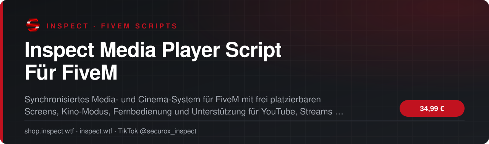
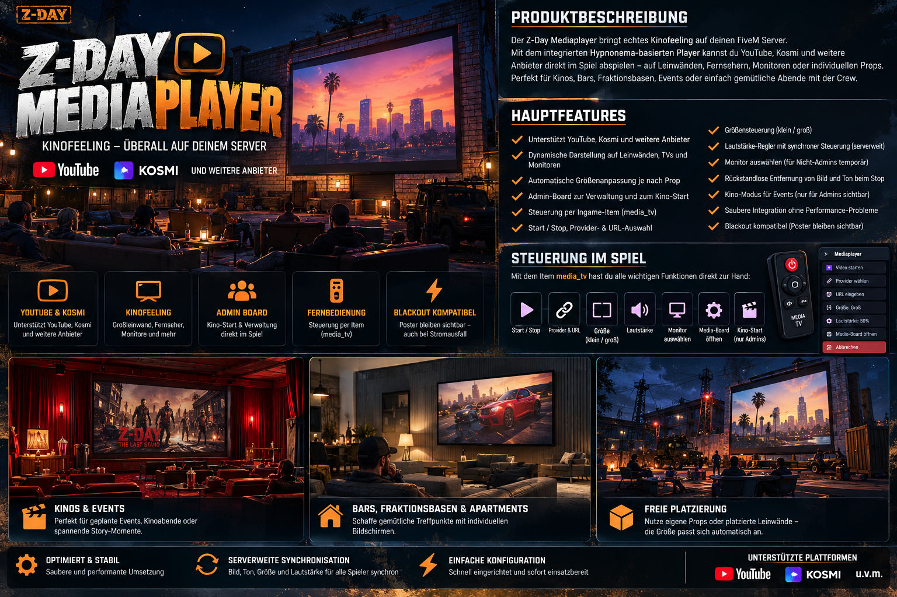

<!-- inspect-showcase: automatisch erzeugt, Änderungen bitte im Shop vornehmen -->

  
  
  
  

<h3>Synchronisiertes Media- und Cinema-System für FiveM mit frei platzierbaren Screens, Kino-Modus, Fernbedienung und Unterstützung für YouTube, Streams und Web-Inhalte.</h3>

  
  
  
  

---

## Überblick

Der Inspect Media Player ist ein umfangreiches, serverweit synchronisiertes Media- und Cinema-System für FiveM. Statt nur einzelne Videos lokal abzuspielen, lassen sich komplette Bildschirme, Leinwände, Monitore und Kino-Flächen direkt in der Spielwelt erstellen, ausrichten und verwalten. Admins können Screens frei zeichnen, skalieren, drehen, an Wände andocken und dauerhaft in der Datenbank speichern oder temporär nutzen. Vorhandene Props können im Kino-Modus als Leinwand verwendet werden, wobei die Bildfläche automatisch an die Prop-Größe angepasst wird. Wiedergabe, Pause, Stop, Lautstärke, Loop, Position und direkte DUI-Interaktionen werden zwischen den Spielern synchronisiert. Unterstützt werden Direct Media, HLS, YouTube, Vimeo, Dailymotion, Streamable, Spotify, Kosmi und normale Webseiten, sofern diese die Einbettung in FiveM/CEF erlauben. Über das Item media_tv steht eine eigene Fernbedienung zur Verfügung, mit der berechtigte Spieler Screens in Reichweite auswählen und steuern können. Zusätzlich können Spieler – sofern aktiviert – eigene temporäre Monitore zeichnen. Separate Render- und Audio-Distanzen, Browser-Parking, Poly-Rendering, Blackout-Render-Fix, Admin-Gruppen und öffentliche Screen-Berechtigungen machen das System flexibel für Kinos, Events, Clubs, Fraktionsräume, Bases, Werbeflächen und individuelle MLOs.

## Funktionen

- ✅ Serverweit synchronisiertes Media- und Cinema-System für FiveM
- ✅ Mehrere Bildschirme und Leinwände gleichzeitig verwaltbar
- ✅ Permanente Screens mit Datenbank-Speicherung
- ✅ Temporäre Screens ohne dauerhafte Speicherung
- ✅ Bildschirme direkt in der Spielwelt frei zeichnen und ausrichten
- ✅ Zwei-Punkt-System zum Festlegen eigener Bildschirmflächen
- ✅ Screens verschieben, skalieren, drehen und neigen
- ✅ Automatisches Andocken an Wände mit einstellbarem Wandabstand gegen Z-Fighting
- ✅ Individuell konfigurierbare Breite und Höhe pro Screen
- ✅ Eigene Sichtweite und separater Audio-Radius pro Screen
- ✅ Serverweit synchronisierte Wiedergabe, Pause, Resume und Stop
- ✅ Synchronisiertes Vor- und Zurückspulen
- ✅ Serverweit synchronisierte Lautstärke und Loop-Funktion
- ✅ Synchronisierte Web-/Kosmi-DUI-Interaktionen für Zuschauer
- ✅ Automatische Provider-Erkennung anhand der eingegebenen URL
- ✅ Unterstützung für Direct Media, HLS, YouTube, Vimeo, Dailymotion, Streamable, Spotify, Kosmi und Web
- ✅ Kino-Modus zur Auswahl vorhandener Props als Leinwand
- ✅ Automatische Größenanpassung der Kino-Fläche an die Boundingbox des ausgewählten Props
- ✅ Fernbedienungs-Item media_tv mit zeitlich begrenzter Remote-Control-Session
- ✅ Fernbedienung wird bei Verwendung nicht verbraucht
- ✅ Normale Spieler können – sofern aktiviert – eigene temporäre Monitore zeichnen
- ✅ Separat konfigurierbare maximale Größe für Spieler-Monitore
- ✅ Admin-Gruppen für owner, superadmin und admin konfigurierbar
- ✅ Öffentliche Bedienung global und pro Screen steuerbar
- ✅ Direkte Screen-Bedienung mit Maus- und Scroll-Interaktion
- ✅ Neue Spieler erhalten den aktuellen synchronisierten Wiedergabestand
- ✅ Browser-Parking zur Wiederverwendung gestoppter DUI-Browser und zur Reduzierung unnötiger Runtime-Texturen
- ✅ Poly-Renderer für robuste Darstellung ohne klassische Scaleform-Abhängigkeit
- ✅ Optionaler Blackout-Render-Fix für Stromausfall- und Spezial-Map-Situationen
- ✅ Konfigurierbare DUI-Auflösung, Standardlautstärke, Renderdistanz und Audio-Distanz
- ✅ URL-Sicherheitsfilter für javascript:, file: und data: Protokolle
- ✅ Eigenständiges NUI Media Board zur zentralen Verwaltung
- ✅ Admin Command: /mediaboard zum Öffnen des Media Boards
- ✅ Admin Command: /kinostart zum Starten der Prop-/Kino-Auswahl
- ✅ Admin Command: /mediabedienen zur direkten Screen-Interaktion
- ✅ Admin Command: /mediazeichnen zum freien Zeichnen eines Screens
- ✅ Geeignet für Kinos, Events, Clubs, Bars, Fraktionsräume, Bases, Schulungen, Meetings, Präsentationen und Werbeflächen
- ✅ Voraussetzungen: ESX / es_extended, ox_lib und oxmysql

## Einblicke

<table>
  <tr>
    <td width="50%"></td>
  </tr>
</table>

## Video

Neue Clips, Updates und Vorschauen gibt es regelmäßig auf TikTok: **[@securox_inspect](https://www.tiktok.com/@securox_inspect)**

## Preise

| Produkt | Preis |
|:--|--:|
| Inspect Media Player Script Für FiveM | **34,99 €** |

<a href="https://shop.inspect.wtf/produkt/inspect-mediaplayer"><b>➜ Zum Produkt im Shop</b></a>

## Kauf, Einrichtung & Support

1. **Kaufen** im offiziellen Shop: [shop.inspect.wtf](https://shop.inspect.wtf) – PayPal und Karte, Rechnung automatisch per E-Mail.
2. **Freischaltung & Download** findest du sofort nach der Zahlung in deinem Kundenkonto.
3. **Hilfe** bekommst du im [INSPECT Discord](https://discord.gg/inspect) – schnell, persönlich und auf Deutsch.

| | |
|:--|:--|
| 🛒 Shop | [shop.inspect.wtf](https://shop.inspect.wtf) |
| 🌐 Website | [inspect.wtf](https://inspect.wtf) |
| 💬 Discord | [discord.gg/inspect](https://discord.gg/inspect) |
| 🎬 TikTok | [@securox_inspect](https://www.tiktok.com/@securox_inspect) |
| ✉️ E-Mail | [info@inspect.wtf](mailto:info@inspect.wtf) |

---

<b>INSPECT</b> · Offizielle Produktpräsentation. Dieses Repository enthält keinen Quellcode und keine Produktdateien. 
Kauf und Lizenzen ausschließlich über <a href="https://shop.inspect.wtf">shop.inspect.wtf</a> · Inhalte werden automatisch aus dem Shop aktualisiert.

